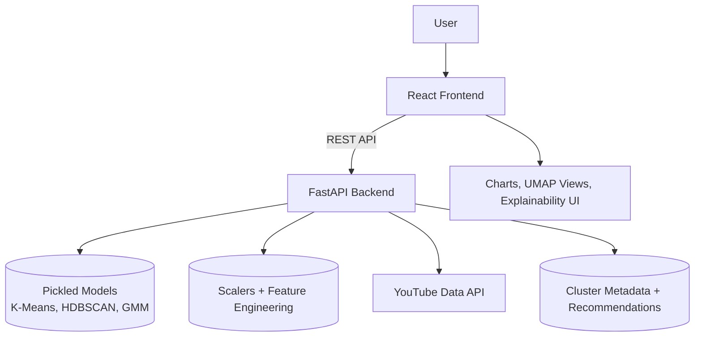
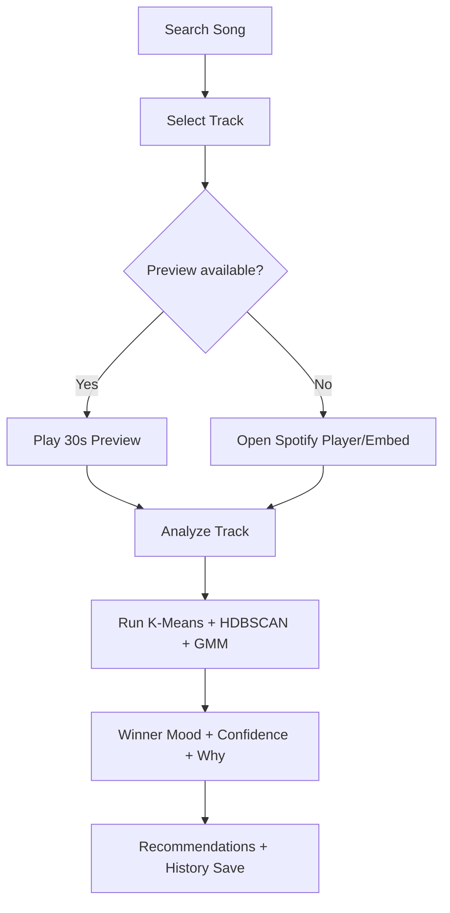
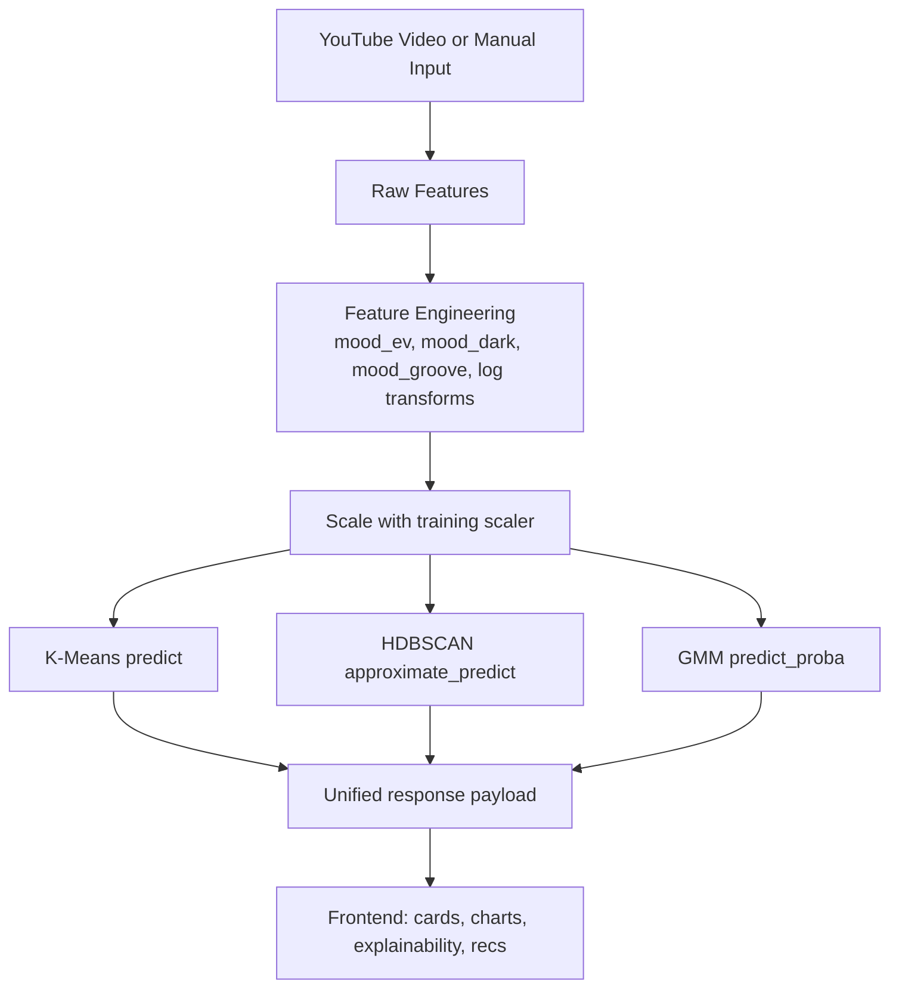
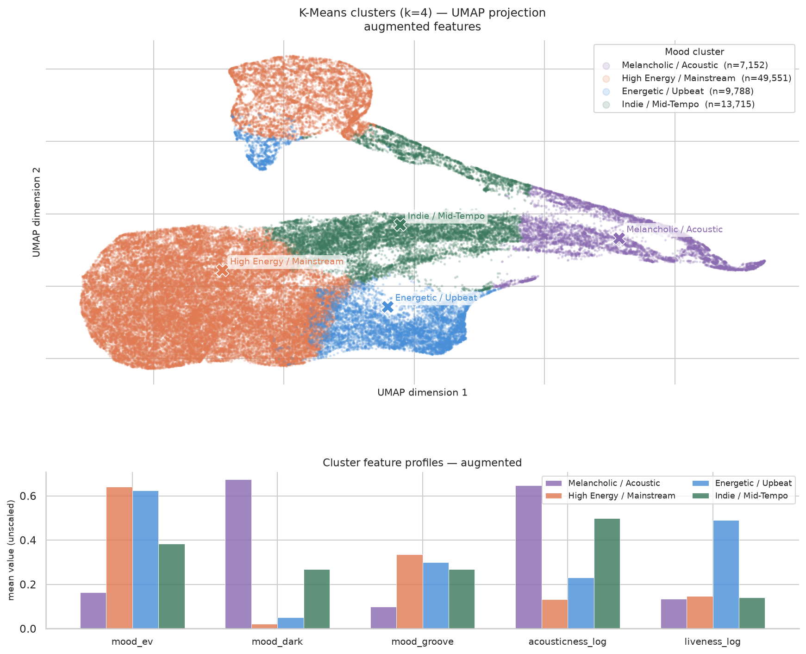
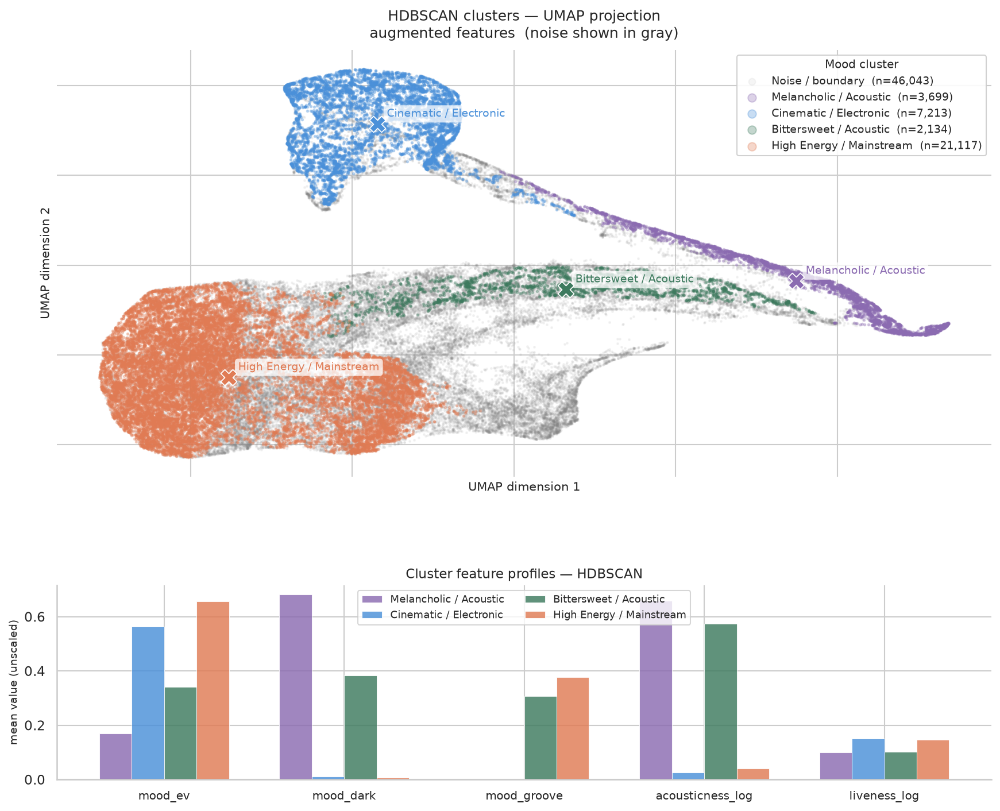
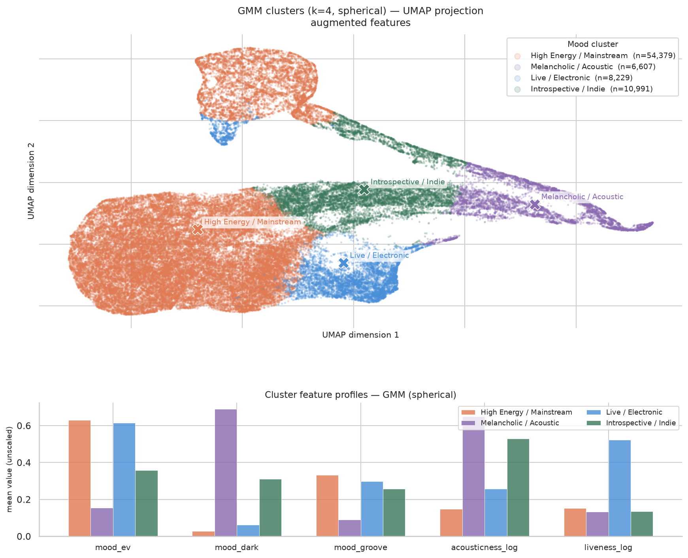

# Music Mood Analyzer

<div align="center">

### Unsupervised clustering for Spotify songs with an interactive research-ready UI


</div>

A full-stack machine learning application that groups songs by mood using unsupervised clustering and a modern, explainable UI.

---


## Why This Project

Genre labels alone are often too coarse to describe how music *feels*. This project reframes music organization around mood dynamics by using:
- engineered feature composites,
- unsupervised clustering,
- and explainable, side-by-side algorithm outputs.

The app lets users search real YouTube music videos, preview songs, run clustering instantly, and understand *why* a specific mood is selected.

---

## Feature Highlights

### MoodMatch Page (core spec feature)
- Four mood buttons: `😊 Happy`, `😢 Sad`, `😡 Angry`, `😌 Calm`
- `GET /playlist?mood=...` samples ~20 real songs from the matching K-Means cluster
- Clusters are labeled automatically by their average valence/energy (quadrant matching), as described in the project spec
- Per-song energy/valence/danceability chips + YouTube play links
- **Camera mood detection (Phase 2):** in-browser face + emotion recognition (Human.js with locally served models — frames never leave the device). Detected emotion is mapped to one of the four moods and the playlist loads automatically. Manual mood buttons remain as fallback.

### Analyze Page
- Guided stepper: `Search -> Select -> Preview -> Analyze -> Result`
- Real-time YouTube suggestions (top results while typing)
- Sticky Now Playing + quick Analyze action
- Automatic YouTube-driven analysis (manual feature entry as fallback)
- Explainability drawer and confidence-rich result hero
- Recent analysis history with playback from history items
- Snapshot sharing (copy JSON, URL token, download)

### Compare Page
- K-Means vs HDBSCAN vs GMM metrics table and charts
- Beginner vs Research view mode toggle
- Interactive UMAP explorer
- Curated findings cards with concise takeaways

### Explore Page
- Cluster cards with profile radar charts
- Mood descriptions, examples, and cluster population cues
- Cross-algorithm agreement callouts for robust patterns

---

## System Architecture



---

## User Journey Flow



---

## Model Pipeline



---

## Results and Conclusions

### 1) K-Means (k=4)
**What stands out**
- `k=3` and `k=4` were nearly tied on silhouette.
- `k=4` was selected for better musical granularity.
- Augmented mood-engineered features outperformed raw features on all major metrics.

**Conclusion**
K-Means is the strongest hard-assignment baseline and provides a clear global map of mood zones.

### 2) HDBSCAN
**What stands out**
- Stable 4-cluster dense core across a wide `min_cluster_size` sweep.
- Large noise ratio reflects boundary ambiguity, not failure.
- Identifies nuanced sub-structures that centroid approaches can merge.

**Conclusion**
HDBSCAN is best when uncertainty honesty is important and forcing every song into a label is undesirable.

### 3) GMM (Gaussian Mixture Model)
**What stands out**
- Soft probabilities provide confidence-ranked mood alternatives.
- Captures overlap behavior more naturally than strict hard labels.
- Best deployed Davies-Bouldin score in this setup.

**Conclusion**
GMM is the project winner for user-facing inference because probabilistic outputs improve interpretability and ranking quality.

### 4) Cross-Algorithm Consensus
The strongest evidence of real structure is repeated agreement on:
- **Melancholic / Acoustic**
- **High Energy / Mainstream**

When fundamentally different methods converge on the same groups, confidence in those mood regions increases substantially.

---

## UMAP Visual Gallery

> These plots are sourced from `frontend/public/plots/`.

### K-Means UMAP



### HDBSCAN UMAP



### GMM UMAP



---

## Metrics Snapshot

| Algorithm | Silhouette (higher better) | Davies-Bouldin (lower better) | Calinski-Harabasz (higher better) | Notes |
|---|---:|---:|---:|---|
| K-Means | 0.3426 | 1.0252 | 79,060 | Strong hard-cluster baseline |
| HDBSCAN | 0.3937* | 1.0058 | 57,801 | `*` on non-noise points only |
| GMM (spherical) | 0.3867 | **0.8878** | 76,641 | Project winner |

Winner rationale served by API: best Davies-Bouldin score plus soft probability assignments.

---

## Tech Stack

### Backend
- FastAPI
- scikit-learn
- hdbscan
- pydantic
- requests

### Frontend
- React 18
- Recharts
- lucide-react
- @vladmandic/human (in-browser face + emotion detection for camera mood)

### Live Metadata + Search
- YouTube Data API v3 (free API key; no premium account required)

### Data and Model Artifacts
- `backend/data1/` for datasets and transformed feature files
- `backend/models/` for trained models and scalers

---

## Project Structure

```text
music_mood_project/
  backend/
    main.py
    requirements.txt
    data1/
    models/
    UML_Project_Music_Mood_Clustering.ipynb
  frontend/
    package.json
    public/plots/
    src/
      api/
      components/
      pages/
```

---

## API Endpoints

Core endpoints in `backend/main.py`:

- `GET /health` - backend/model/YouTube health state
- `GET /playlist?mood=happy&limit=20` - MoodMatch: random sample of songs from the mood's cluster
- `GET /moods` - the four moods with cluster mapping + song counts
- `POST /analyze` - analyze manual feature payload
- `POST /analyze-video/{video_id}` - analyze directly from YouTube video ID
- `GET /youtube/search?q=...&limit=...` - YouTube search suggestions
- `GET /youtube/track-info/{video_id}` - resolved video + estimated feature payload
- `GET /algorithm-comparison` - comparison page metric payload
- `GET /cluster-overview` - cluster metadata for explore views
- `GET /recommendations/{mood}` - recommendations by mood label

---

## Setup and Run

### Prerequisites
- Python 3.10+ (recommended 3.11+)
- Node.js 18+ and npm
- YouTube Data API v3 key for live search + video metadata (free; no premium account)

### 1) Backend

```powershell
Set-Location "D:\Projects\UML Project\music_mood_project\music_mood_project\backend"
python -m pip install -r requirements.txt
uvicorn main:app --reload --port 8756
```

Create `.env` in either `backend/.env` or project root:

```env
YOUTUBE_API_KEY=your_youtube_api_key
BACKEND_CORS_ORIGINS=http://localhost:3000
```

### 2) Frontend

```powershell
Set-Location "D:\Projects\UML Project\music_mood_project\music_mood_project\frontend"
npm install
npm start
```

Optional frontend env file (`frontend/.env`) for production-style API target:

```env
REACT_APP_API_BASE_URL=http://localhost:8756
```

Frontend: `http://localhost:3000`  
Backend: `http://localhost:8756`

---

## YouTube Integration Notes

- YouTube Data API v3 powers search and video metadata. It only needs a free API key (Google Cloud Console → Credentials → API key with "YouTube Data API v3" enabled) — no premium account.
- Quota note: `search.list` costs 100 units of the free 10,000/day quota (~100 searches/day); `videos.list` costs 1 unit.
- If the API key is missing/invalid or quota is exhausted, YouTube endpoints return service-unavailable behavior and the UI falls back to manual feature entry.
- YouTube exposes no audio features, so mood features are estimated heuristically from video metadata (title/channel keyword hints, views, likes, duration, age). The result payload flags this via `feature_source: "youtube_metadata_heuristic"`.
- The trained models (K-Means, HDBSCAN, GMM) were trained on a Spotify-sourced dataset; the live integration only supplies estimated feature inputs.